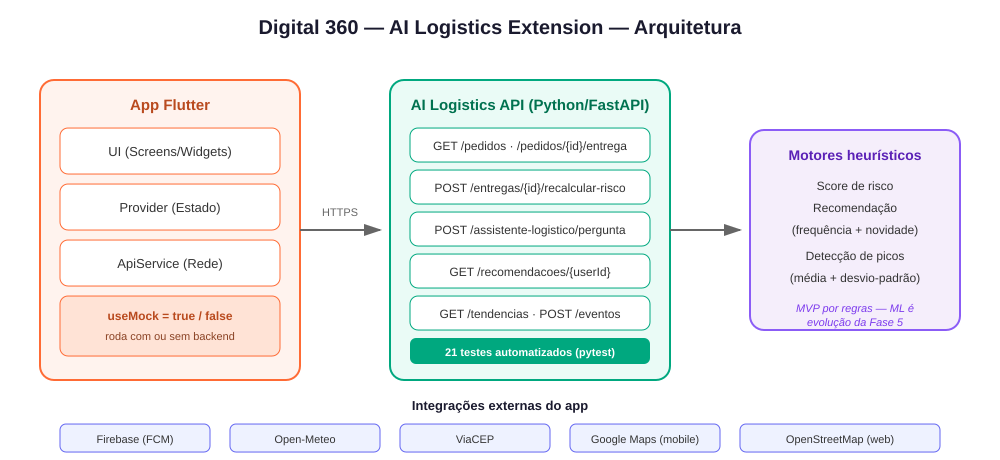

# Digital 360 - Smart HAS | Inclusão digital para idosos e pessoas com deficiência

App mobile em **Flutter/Dart** que ajuda idosos, pessoas com deficiência e quem tem pouca
familiaridade com tecnologia a usar o celular com autonomia: aprender o básico, chegar aos
serviços públicos de que precisam (INSS, SUS, gov.br, documentos, benefícios) e acompanhar
as próprias compras e entregas sem depender de terceiros.

Entregue para a **Global Solution 2 – 2026 (CitizenTech: tecnologia centrada no cidadão)**.
O projeto nasceu no Enterprise Challenge FIAP como **Smart HAS / Digital 360**, primeiro em
Kotlin e depois reimplementado em Flutter. A camada de logística (AI Logistics Extension) foi
criada com a mentoria da Leroy Merlin.

> A versão em texto exigida pela GS está em [`README.txt`](README.txt). Os roteiros dos vídeos
> e os arquivos `.txt` com os links da entrega estão em [`docs/gs2/`](docs/gs2/).

## Grupo
- Eduardo Andrade Martins Vasques - RM 556970
- Otavio Ramos dos Santos Souza - RM 550361
- Enzo Miranda Ward de Paiva - RM 557632
- Rafael Pinto de Albuquerque - RM 559136
- Guilherme Leoni Vidigal Tiburcio - RM 557500

## O problema e a proposta (CitizenTech)

**Problema real.** Serviços essenciais migraram para o celular, como o extrato do INSS, o
agendamento no SUS, a 2ª via de documentos, o Bolsa Família e o Pix. Quem não domina o
aparelho fica dependente de filhos, vizinhos ou atendentes. Fica também mais exposto a golpes
digitais e deixa de exercer direitos que já tem. Esse público inclui idosos, pessoas com
deficiência visual ou motora e adultos com baixo letramento digital. Os apps de governo e de
varejo raramente são pensados para ele: letra pequena, muitos passos e nenhuma ajuda por voz.

**Em números:**
- **1 em cada 4 brasileiros com 60 anos ou mais não usou a internet em 2025.** Entre os
  idosos, 74,5% usaram, contra 91,8% na faixa de 50 a 59 anos. É o menor percentual entre
  todas as faixas etárias. Fonte: IBGE, PNAD Contínua TIC 2025.
- **"Não saber utilizar" é o principal motivo** de quem não usa a internet, citado por 44,9%
  das pessoas de 10 anos ou mais que estão fora da rede. Motivos econômicos somam 9%. Fonte:
  IBGE, PNAD Contínua TIC 2025.
- **16 milhões dos 28 milhões de brasileiros que não usam a internet têm mais de 60 anos.**
  Fonte: Cetic.br/NIC.br, TIC Domicílios 2025.

Ou seja, o maior obstáculo não é o preço nem a falta de sinal, mas saber usar. É nisso que o
app atua.

<sub>Fontes: IBGE, PNAD Contínua TIC 2025, divulgada em 02/07/2026 e noticiada pela
[Teletime](https://teletime.com.br/02/07/2026/usuarios-internet-brasil-ultrapassa-90/).
Cetic.br/NIC.br, TIC Domicílios 2025, noticiada pela
[Viva](https://viva.com.br/tecnologia/28-milhoes-de-brasileiros-nao-usam-internet-a-maioria-acima-dos-60-anos.html).
As duas pesquisas usam metodologias diferentes, então os totais de não usuários não são
comparáveis entre si.</sub>

**Público beneficiado.** Idosos, pessoas com deficiência, cidadãos com baixo letramento digital
e os cuidadores e familiares que os apoiam.

**Proposta de valor.** Um único app, com interface simples e acessível (fonte ajustável, alto
contraste, leitura em voz alta e busca por voz), que:

1. **Ensina** o uso do celular e dos serviços digitais em trilhas curtas: primeiros passos,
   gov.br, segurança contra golpes e Pix.
2. **Orienta** o acesso a serviços públicos e direitos (INSS, SUS, documentos, assistência
   social, Estatuto do Idoso), com o passo a passo de cada um lido em voz alta.
3. **Acompanha** as compras e entregas do cidadão. O app calcula o risco de atraso com base no
   clima real da região, avisa com antecedência e permite reagendar com um toque.
4. **Conecta** a pessoa a uma rede de apoio: o modo cuidador, em que um familiar acompanha o
   progresso, e um fórum em que a comunidade tira dúvidas e cria cursos.

## Relação com os Objetivos de Desenvolvimento Sustentável (ODS)

| ODS | Meta | Como o app contribui |
|---|---|---|
| **ODS 10 – Redução das desigualdades** (principal) | 10.2: promover a inclusão social, econômica e política de todos, independentemente da idade e da deficiência | Diminui a exclusão digital de idosos e pessoas com deficiência, que hoje dependem de terceiros para acessar benefícios, saúde e documentos. Leitura em voz alta, busca por voz, fonte ajustável e alto contraste removem barreiras de uso. |
| **ODS 4 – Educação de qualidade** | 4.4: ampliar as competências digitais de jovens e adultos. 4.5: garantir acesso à educação para pessoas com deficiência e em situação de vulnerabilidade | As trilhas de aprendizagem ensinam habilidades digitais do dia a dia. A comunidade cria cursos novos, e o certificado de conclusão valoriza o aprendizado. |
| **ODS 9 – Indústria, inovação e infraestrutura** | 9.c: ampliar o acesso às tecnologias de informação e comunicação | Leva o acesso aos serviços digitais a quem já tem celular, mas não consegue usá-lo plenamente. |

## As 3 funcionalidades principais (além de login e cadastro)

| # | Funcionalidade | Valor para o cidadão | Onde está no código |
|---|---|---|---|
| 1 | **Trilhas de aprendizagem digital** | Cursos curtos sobre o uso do celular, o gov.br, golpes e o Pix, com progresso salvo, conteúdo lido em voz alta, certificado em PDF e cursos criados pela comunidade | `lib/ui/screens/cursos_screen.dart`, `detalhe_curso_screen.dart`, `licao_modulo_screen.dart`, `lib/providers/cursos_provider.dart`, `lib/data/services/certificado_service.dart` |
| 2 | **Guia de serviços públicos e direitos** | Busca por texto ou voz, passo a passo lido em voz alta, favoritos e histórico de buscas, cobrindo INSS, SUS, documentos, Bolsa Família e Estatuto do Idoso | `lib/ui/screens/guia_screen.dart`, `detalhe_servico_screen.dart`, `lib/providers/servicos_provider.dart`, `lib/data/services/tts_service.dart` |
| 3 | **Acompanhamento de entregas com alerta de risco** | Mostra o risco de atraso calculado com o clima real (Open-Meteo), envia notificação nos riscos ALTO e CRÍTICO, permite reagendar com 1 toque e avaliar a entrega, e exibe o mapa da rota | `lib/ui/screens/logistica_screen.dart`, `detalhe_entrega_screen.dart`, `mapa_screen.dart`, `lib/providers/logistica_provider.dart`, `lib/data/services/weather_service.dart` |

Funcionalidades complementares: modo cuidador (`acompanhamento_screen.dart`), fórum
(`forum_screen.dart`), gamificação (`conquistas_screen.dart`), assistente
(`assistente_screen.dart`, que é baseado em regras e não usa IA generativa) e painel de impacto
(`impacto_screen.dart`).

## Gerenciamento de memória e eficiência

Boas práticas aplicadas no app Flutter. Os números vêm de uma busca no código de `lib/`.

| Prática | Como aparece no código | Por que importa |
|---|---|---|
| **Liberação de controllers em `dispose()`** | 10 telas com estado sobrescrevem `dispose()` e liberam 25 recursos (a maioria `TextEditingController`, além de um `ScrollController` e um `PageController`). Exemplos: `login_screen.dart`, `register_screen.dart`, `assistente_screen.dart`, `guia_screen.dart`, `onboarding_screen.dart` | Controllers mantêm listeners e buffers nativos. Sem `dispose()`, cada abertura de tela deixaria objetos presos na memória (vazamento). |
| **Checagem de `mounted` após `await`** | 25 checagens `if (!mounted)` ou `context.mounted` antes de usar `setState` ou `context` depois de chamadas assíncronas | Evita atualizar um widget que já saiu da árvore. Isso geraria erro e manteria referências vivas sem necessidade. |
| **Widgets `const`** | Cerca de 740 usos de construtores `const` em `lib/` | Widgets `const` são criados uma única vez e reaproveitados. O Flutter pula a reconstrução deles, o que poupa alocação e trabalho do *garbage collector*. |
| **Listas preguiçosas (`ListView.builder` / `.separated`)** | 7 telas: cursos, guia de serviços, logística, fórum, assistente, meus cursos e acompanhamento | Só os itens visíveis são construídos. A memória fica estável mesmo com listas grandes. |
| **Rebuild seletivo com Provider** | Um `ChangeNotifier` por domínio (10 providers em `main.dart`). `context.watch` só onde a tela precisa redesenhar. 69 usos de `context.read` em callbacks, que não registram escuta | Uma mudança de estado redesenha só as telas interessadas, e não o app inteiro. |
| **Singleton de rede com cliente HTTP reutilizado** | `ApiService.instance` com um único `http.Client` (`lib/data/services/api_service.dart`) | Uma instância serve todos os providers. Ninguém duplica estado nem abre conexões novas a cada chamada, e o cliente aproveita o *pool* de conexões. |
| **Timeout em todas as chamadas de rede** | 10 s na API e 8 s no ViaCEP, Open-Meteo e GPS | Requisições penduradas não ficam segurando memória nem a tela de carregamento indefinidamente. |
| **Coleções com limite** | Histórico de buscas limitado a 8 itens, sem duplicatas (`servicos_provider.dart`, `_maxHistorico`) | O dado salvo localmente não cresce sem controle. |
| **Recursos pesados sob demanda** | O certificado em PDF só é gerado quando o usuário pede (`certificado_service.dart`). As telas de detalhe são criadas ao navegar e descartadas ao voltar | Não ocupa memória com algo que a maioria dos usuários não usa a cada sessão. |
| **Escolha consciente de `IndexedStack`** | A tela inicial mantém as 5 abas vivas, incluindo o mapa (`home_screen.dart`) | É uma troca deliberada: gasta um pouco mais de memória para preservar rolagem e estado e evitar refazer as chamadas de rede ao trocar de aba. Com só 5 abas, o custo é pequeno e economiza dados móveis, o que importa para o público do app. |
| **Build de release** | `flutter build web --release` no CI (`.github/workflows/ci-cd.yml`) e em `deploy/app_web_docker.sh` | O código é compilado e passa por *tree shaking*, que remove código e ícones não usados e reduz o tamanho do pacote e o consumo de memória. |

**Ponto de melhoria identificado.** Os controllers das telas são todos liberados, mas 7
`TextEditingController` criados dentro de diálogos ainda não recebem `dispose()`. São os
diálogos de código do cuidador, comentário de curso, avaliação de entrega, nova pergunta do
fórum (2), "esqueci minha senha" e edição de nome. O impacto é pequeno, porque cada um só vive
enquanto o diálogo está aberto. A correção planejada é mover cada diálogo para um widget com
estado próprio, que libera o controller no seu `dispose()`. Fazer o `dispose()` logo depois de
`await showDialog(...)` não serve, porque a animação de saída ainda usa o controller.

## Tecnologias adotadas e benefícios

| Tecnologia | Onde | Por que foi escolhida |
|---|---|---|
| **Flutter + Dart** | `lib/` | Um único código para Android, iOS e web, com interface idêntica nas três plataformas. Tem o *hot reload* para iterar rápido no design acessível e componentes Material 3 com suporte nativo a escala de fonte e leitores de tela. |
| **Provider** (`ChangeNotifier`) | `lib/providers/` | É a gestão de estado recomendada pela documentação do Flutter. Simples de testar (há testes de todos os providers) e com rebuild seletivo. |
| **http** | `api_service.dart` | Cliente REST leve, com suporte a timeout e reaproveitamento de conexão. |
| **flutter_tts / speech_to_text** | `tts_service.dart`, `guia_screen.dart` | Leitura em voz alta e busca por voz para quem tem dificuldade de leitura ou de digitação. |
| **flutter_secure_storage / local_auth** | `session_service.dart`, `biometria_service.dart` | Tokens guardados no Keystore ou Keychain. O login por digital poupa o idoso de digitar a senha toda vez. |
| **shared_preferences** | `perfil_local_service.dart`, providers | Guarda preferências como fonte, tema, favoritos e histórico sem precisar de servidor. |
| **google_maps_flutter / flutter_map (OpenStreetMap) / geolocator** | `mapa_screen.dart`, `location_service.dart` | Mapa da entrega. A versão web usa OpenStreetMap, que funciona sem chave paga. |
| **Firebase (FCM, Analytics, Crashlytics) / flutter_local_notifications** | `notification_service.dart`, `analytics_service.dart` | Avisos de risco de atraso com deep link para o pedido, além de monitoramento de uso e falhas. |
| **pdf / printing / share_plus** | `certificado_service.dart`, `indicacao_screen.dart` | Certificado de conclusão gerado no próprio aparelho e compartilhamento pelo menu nativo do sistema. |
| **Open-Meteo e ViaCEP** | `weather_service.dart`, `viacep_service.dart` | APIs públicas e gratuitas. O clima entra de fato no cálculo do risco de entrega. |
| **Java 21 + Spring Boot** | `backend-java/` | API REST com JWT, H2 para desenvolvimento e integração JDBC com o Oracle. |
| **Python + FastAPI** | `backend/` | Back-end das heurísticas de recomendação, risco e sazonalidade, com testes em pytest. |
| **Oracle Database + PL/SQL** | `database-oracle/` | Regras de negócio perto dos dados: cálculo de risco, alertas de sensores, relatórios e auditoria por trigger. |
| **Docker e GitHub Actions** | `deploy/`, `.github/workflows/ci-cd.yml` | Ambiente de homologação reproduzível e pipeline que testa e publica a cada push. |

## Modelo de dados (MER e DER) e automação PL/SQL

- **MER (modelo conceitual):** [`database-oracle/MER_SmartHAS.md`](database-oracle/MER_SmartHAS.md)
- **DER (modelo lógico/físico, 12 tabelas):** [`database-oracle/DER_SmartHAS.png`](database-oracle/DER_SmartHAS.png) (fonte em `DER_SmartHAS.mmd`)
- **Rotinas PL/SQL que automatizam o processo:**
  - `PKG_SH_RISCO`: calcula o score de risco de cada entrega e grava o histórico e a recomendação (`SP_RECALCULAR_RISCO`).
  - `PKG_SH_IOT`: transforma leituras de sensores fora do limite em alertas e permite resolvê-los.
  - `PKG_SH_USUARIO`: calcula o progresso médio do usuário nos cursos e gera o relatório consolidado (indicadores por usuário).
  - `PKG_SH_CONSULTA`: busca e resumo de pedidos com Dynamic SQL e proteção contra SQL Injection.
  - Triggers `TRG_SH_ALERTA_AUDITORIA` (auditoria de cada mudança de alerta) e `TRG_SH_PEDIDO_ENTREGUE` (encerra os alertas quando a entrega é concluída).

## Arquitetura



O backend real da AI Logistics Extension está na pasta [`backend/`](backend/)
deste repositório (Python/FastAPI) - implementa de fato os endpoints que antes só
existiam mockados no app (recomendação, risco, assistente, detecção de sazonalidade,
reagendamento, feedback, renovação de sessão). Ver [`backend/README.md`](backend/README.md)
para detalhes e testes.

## Consolidando o Smart HAS — Oracle PL/SQL e CI/CD

| Item | Onde está |
|---|---|
| Modelo Oracle (12 tabelas), dados simulados | [`database-oracle/`](database-oracle/) (`01_ddl_tabelas.sql`, `02_dados_simulados.sql`) |
| 4 packages: risco, IoT, usuário e consultas | `03_pkg_sh_risco.sql`, `04_pkg_sh_iot.sql`, `05_pkg_sh_usuario.sql`, `06_pkg_sh_consulta.sql` |
| Dynamic SQL (`DBMS_SQL` e `OPEN FOR`) | `06_pkg_sh_consulta.sql`, endpoints `/oracle/pedidos/busca` e `/oracle/pedidos/resumo` |
| 2 triggers: auditoria e automação | `07_triggers.sql` |
| Testes PL/SQL automatizados e demonstração | `09_testes_automatizados.sql`, `08_testes_e_consultas.sql` |
| Integração REST → Java → JDBC → Oracle | `backend-java/src/main/java/com/smarthas/backend/plsql/` (endpoints `/oracle/**`, ligados com `ORACLE_ENABLED=true`) |
| Pipeline CI/CD | [`.github/workflows/ci-cd.yml`](.github/workflows/ci-cd.yml) e [`deploy/`](deploy/) |
| Documentação da entrega | [`docs/fase7/`](docs/fase7/) (Fase 6 em [`docs/fase6/`](docs/fase6/)) |

Sem `ORACLE_ENABLED=true`, o `backend-java` sobe exatamente como na Fase 5 (só H2).

**Rodar tudo localmente** (precisa só do Docker; API em `http://localhost:8080/swagger-ui.html`,
Oracle em `localhost:1521/FREEPDB1`):

```bash
bash deploy/deploy_homolog.sh                                 # sobe, instala e valida
bash deploy/app_web_docker.sh                                 # app em http://localhost:5000
docker compose -f deploy/docker-compose.homolog.yml down -v   # encerra o back-end e o Oracle
docker rm -f smarthas-app-web                                 # encerra o app
```

No app, escolha **Java** em Configurações → Conexão (avançado) para usar esse back-end.

## Funcionalidades

| Área | O que tem |
|---|---|
| Aprendizagem | Trilhas com progresso real (botão "Continuar curso" avança de verdade) e celebração ao concluir |
| Cursos comunitários | Qualquer usuário pode virar tutor e criar/publicar cursos direto (sem fila de aprovação), com rascunho inicial gerado por heurística de template (não IA generativa) |
| Comunidade | Fórum de perguntas e respostas, gamificação (cursos concluídos, sequência de dias, pontos, ranking) e painel de impacto com números da base atual |
| Cuidador e engajamento | Modo cuidador (acompanhamento somente-leitura), certificado de conclusão em PDF, indicação de amigos (share sheet do SO), cupom de recompensa simbólico e avaliação de cursos com perfil público do tutor |
| LGPD / privacidade | Tela de Política de Privacidade, aceite obrigatório no cadastro, CPF mascarado por padrão no Perfil (com opção de revelar) e exclusão da própria conta |
| Acessibilidade adicional | Tema em 3 vias (sistema/claro/escuro), onboarding com passo de perfil (idoso/cuidador/pessoa com deficiência) que personaliza a dica final, e gancho preparado para vídeo em Libras nos cursos |
| Guia de serviços | Busca por texto **e por voz**, favoritos, filtro "somente favoritos", histórico de buscas recentes, leitura em voz alta (TTS) |
| AI Logistics | Risco de entrega (agora considerando o clima real da região), reagendamento com 1 toque, avaliação pós-entrega, telas de **Recomendações** e **Tendências/Sazonalidade** |
| Assistente de IA | Chat com rolagem automática, seletor de pedido, histórico salvo entre sessões |
| Conta | Cadastro com CPF validado (dígitos verificadores) e máscara, login, login biométrico (reautentica sessão salva), "esqueci minha senha", renovação automática de sessão (refresh token), editar nome, CPF/nome completo visíveis no perfil |
| Acessibilidade | Tema claro/escuro, ajuste de tamanho de fonte, onboarding na primeira abertura, notificações configuráveis |
| Robustez | Timeout em todas as chamadas de rede, mensagens de erro amigáveis (diferenciando sem-conexão de erro de servidor), tokens de sessão em armazenamento seguro (Keystore/Keychain), Analytics + Crashlytics (mesmo padrão defensivo do FCM) |
| Notificações | Alertas locais de risco ALTO/CRÍTICO com deep link — tocar na notificação abre direto a tela do pedido |

## Como o projeto atende à Fase 4 / AI Logistics Extension
| Parte | Onde está no código |
|------|----------------------|
| Flutter (widgets, estado, componentização) | `lib/ui/`, `lib/providers/` (Provider/ChangeNotifier) |
| Padrão de estado | **Provider** - 1 ChangeNotifier por domínio (auth, cursos, serviços, logística, configurações) |
| Mapas e geolocalização | `lib/ui/screens/mapa_screen.dart` - Google Maps no mobile, **OpenStreetMap na web** (sem chave) |
| 2+ web services | `weather_service.dart` (Open-Meteo) e `viacep_service.dart` (ViaCEP) - ambos reais, sem chave, e o clima **alimenta de verdade** o cálculo de risco |
| Firebase + FCM push | `lib/data/services/notification_service.dart` (Firebase Core + FCM + notificação local, configurável em Perfil > Configurações) |
| AI Logistics Extension (backend real) | [`backend/`](backend/) - recomendação, risco, assistente, sazonalidade, reagendamento, feedback |

## Estrutura (camadas)
```
lib/
  core/        -> tema claro/escuro, cores Smart HAS, constantes, utilitarios (CPF)
  data/
    models/    -> Usuario, Curso, Servico, PedidoLogistico, RiscoLogistico
    services/  -> ApiService (singleton, mock+real, com retry de sessao),
                  WeatherService, ViaCepService, NotificationService (FCM),
                  LocationService, SessionService (secure storage), TtsService,
                  PerfilLocalService
  providers/   -> AuthProvider, CursosProvider, ServicosProvider,
                  LogisticaProvider, SettingsProvider, RecomendacoesProvider,
                  CursoAutoriaProvider, ForumProvider, GamificacaoProvider,
                  CuidadorProvider
  ui/
    screens/   -> Splash, Onboarding, Login, Register, Home (bottom nav),
                  Cursos+detalhe, CriarCurso, MeusCursos, Guia+detalhe,
                  Logistica+detalhe entrega, Assistente, Mapa, Recomendacoes,
                  Tendencias, Configuracoes, Perfil, Creditos, Forum+detalhe
                  pergunta, Conquistas, Impacto, Acompanhamento, Indicacao,
                  TutorPerfil
    widgets/   -> RiskBadge, StatusChip, NivelBadge, ComunidadeBadge,
                  OfflineBanner, EmptyState, StatCard, LibrasVideoPlaceholder
```
Fluxo: **UI -> Provider (estado) -> Service (rede) -> Model**. Equivale ao MVVM
(ViewModel/Repository) do projeto Kotlin original.

## Rodar o projeto
> Requer Flutter SDK 3.4+ instalado (`flutter --version`).

1. Gere o scaffolding nativo (cria as pastas `android/`, `web/` etc. que faltam,
   **sem apagar `lib/`**):
   ```bash
   flutter create . --org br.com.fiap --project-name digital360_flutter
   ```
2. Baixe as dependências:
   ```bash
   flutter pub get
   ```
3. Rode (mobile/emulador):
   ```bash
   flutter run
   ```
   Ou no navegador (usa OpenStreetMap no mapa, sem precisar de chave):
   ```bash
   flutter run -d chrome
   ```

O app já roda **sem backend**: o ambiente padrão é **Mock**, com dados idênticos aos
usados nos testes automatizados de heurística do backend real. Para usar um backend
real, escolha **Python** ou **Java** em Configurações → Conexão (avançado). Os
endereços ficam em `lib/core/constants/api_constants.dart`. Veja como subir os
backends em [`backend/README.md`](backend/README.md) e
[`backend-java/README.md`](backend-java/README.md).

## Configurar chaves (opcional, apenas para o mapa mobile)
- **Google Maps** (só necessário no Android/iOS - a versão web usa OpenStreetMap
  sem chave): em `android/app/src/main/AndroidManifest.xml`, troque
  `YOUR_GOOGLE_MAPS_API_KEY` pela sua chave (Google Cloud > Maps SDK for Android).
- **Firebase/FCM**: troque `android/app/google-services.json` pelo arquivo real do
  console Firebase (mesmo package `br.com.fiap.digital360`).
  Sem isso, o push fica em modo local (a notificação simulada ainda funciona).

## Web services usados
1. **Open-Meteo** (`https://api.open-meteo.com`) - clima na região de entrega; o
   resultado **alimenta de verdade** o cálculo de risco logístico (não é só texto
   informativo). Sem API key.
2. **ViaCEP** (`https://viacep.com.br`) - resolve endereço completo a partir do CEP
   para validar o destino da entrega. Sem API key.

## Notificação push
- Perfil > Configurações permite ligar/desligar os alertas de entrega.
- Em "Detalhe da entrega", ao recalcular risco ALTO/CRÍTICO (com o alerta ativo),
  o app dispara automaticamente uma notificação local.
- Com Firebase configurado, mensagens FCM recebidas com o app aberto viram notificação.
- Tocar na notificação de risco abre direto a tela do pedido (deep link) - a navegação
  usa um `navigatorKey` global registrado em `main.dart`, mantendo `NotificationService`
  independente de telas/providers específicos (ele só repassa o payload).

## Acessibilidade
Pensado para o público-alvo (idosos, baixo letramento digital):
- Tema claro **ou** escuro, ambos de alto contraste.
- Ajuste de tamanho de fonte (Perfil > Configurações).
- Leitura em voz alta (TTS) do conteúdo de cursos e serviços.
- Busca por voz no Guia de Serviços.
- Onboarding de 3 telas na primeira abertura.
- Confirmação antes de ações sensíveis (reagendar entrega, sair da conta).

## Testes
```bash
flutter test
```
80 testes automatizados: widgets (RiskBadge, StatusChip, NivelBadge), um golden test do
RiskBadge (execução local), telas com estado assíncrono (`AssistenteScreen`,
`TendenciasScreen`, `RecomendacoesScreen`, `ConfiguracoesScreen`, incluindo o toggle de
biometria), validação de login,
validação de CPF (incluindo o formatador de máscara de digitação e a máscara de
exibição), heurística de risco/assistente (`MockData`), o onboarding ramificado por
perfil, e os providers `AuthProvider`, `CursosProvider`, `ServicosProvider`,
`LogisticaProvider`, `RecomendacoesProvider`, `CursoAutoriaProvider`, `ForumProvider`,
`GamificacaoProvider`, `CuidadorProvider` e `SettingsProvider` (incluindo reagendamento,
impacto do clima no risco, o fluxo de virar tutor/gerar rascunho/publicar curso,
perguntar/responder no fórum, registrar conclusão de curso e refletir no resumo de
gamificação, vincular-se como cuidador, excluir a própria conta, o tema em 3 vias,
histórico de buscas recentes, e um teste de regressão para o carregamento assíncrono
de favoritos).

**Achado real durante a escrita destes testes**: `AuthProvider.login()` grava a sessão
via `flutter_secure_storage` (um plugin com implementação nativa por `MethodChannel`).
Dentro de `testWidgets()` (modo de teste de widget, sem binding de plataforma real por
trás), chamar `login()` de verdade trava o teste indefinidamente esperando uma resposta
de plataforma que nunca chega. A correção nos testes de tela foi popular o `Usuario`
diretamente no provider (sem passar pelo `SessionService`) - os testes que chamam
`login()` de verdade (ex.: `auth_provider_test.dart`) usam `test()` puro, sem
`testWidgets()`, e por isso não são afetados.

### Teste de integração ponta-a-ponta (`integration_test/app_test.dart`)
Cobre o fluxo completo: login em modo demonstração → navega para Cursos → avança o
progresso de um curso → volta ao Perfil → sai da conta. Está escrito e correto, mas
**não foi possível executá-lo de fato neste ambiente de desenvolvimento** - tentativa
honesta com as 3 rotas disponíveis:
- **Windows desktop**: projeto sem o scaffolding `windows/` (não configurado).
- **Chrome/Edge via `flutter test`**: `flutter test` não suporta devices web para
  integration tests (é preciso `flutter drive` + um servidor `chromedriver` rodando na
  porta 4444, que não está instalado neste ambiente).
- **Emulador Android**: o emulador inicia normalmente, mas o build Gradle falha com
  `Unable to establish loopback connection` - uma restrição de rede/firewall deste
  ambiente Windows específico, não um bug no código do app. Tentativa de contorno:
  desligar o Gradle Daemon (`org.gradle.daemon=false` em `android/gradle.properties`,
  já commitado) não resolveu - o mesmo erro persiste mesmo sem o daemon, indicando que
  o bloqueio está em outro processo Gradle/JVM que também usa loopback (não algo
  ajustável só por configuração de projeto).

Para rodar de verdade num ambiente sem esse bloqueio de rede (outra máquina, ou este
mesmo ambiente com uma exceção de firewall para `java.exe`/Gradle), ou um `chromedriver`
instalado:
```bash
flutter test integration_test/app_test.dart -d <emulator-id>
# ou, para a web:
flutter drive --driver=test_driver/integration_test.dart --target=integration_test/app_test.dart -d chrome
```

## Limitações conhecidas
- O mapa mobile (Android/iOS) depende de uma chave real do Google Maps que o grupo
  optou por não commitar publicamente, por segurança. A versão web usa OpenStreetMap
  e funciona sem nenhuma chave.
- Busca por voz e leitura em voz alta dependem do suporte do navegador/dispositivo
  (e de permissão de microfone no caso da busca por voz) - ambas falham de forma
  silenciosa e sem quebrar a tela quando indisponíveis.
- O backend real (`backend/`) é um MVP heurístico (regras), não Machine Learning
  treinado - decisão consciente alinhada à orientação da mentoria Leroy Merlin
  ("comece simples, escale com consistência"). A evolução para ML com dados reais
  é o próximo passo planejado (ver README do backend).
- O backend real agora tem persistência de verdade (SQLite) e autenticação JWT real
  (cadastro/login próprios, token validado por assinatura, CORS restrito por lista
  de origens) - ver [`backend/README.md`](backend/README.md) para detalhes.
- O teste de integração ponta-a-ponta (`integration_test/app_test.dart`, seção
  acima) está escrito, mas nunca foi executado com sucesso neste ambiente de
  desenvolvimento - rodar numa máquina sem o bloqueio de rede do Gradle (ou com
  `chromedriver` instalado) é o próximo passo natural para validá-lo de fato.
