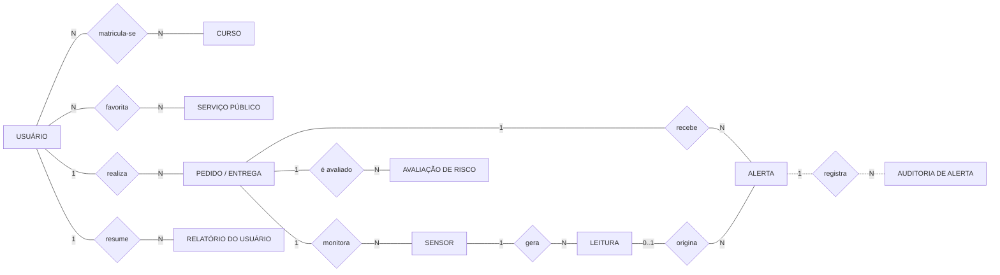

# MER – Modelo Entidade-Relacionamento (conceitual) · Smart HAS / Digital 360

O MER descreve **o que** o sistema precisa guardar, em linguagem de negócio e sem detalhes de
banco. O **DER** ([`DER_SmartHAS.png`](DER_SmartHAS.png)) traduz este modelo para as 12 tabelas
Oracle de [`01_ddl_tabelas.sql`](01_ddl_tabelas.sql), com tipos, PKs e FKs.

## Diagrama conceitual (notação de Chen)

Retângulos são entidades, losangos são relacionamentos e os números indicam a cardinalidade.

## Entidades e atributos

| Entidade | Descrição | Atributos principais (identificador sublinhado) |
|---|---|---|
| **Usuário** | Cidadão atendido pelo app (idoso, adulto, estudante) ou tutor que cria cursos | <u>código</u>, nome, login, CPF, data de nascimento, perfil (IDOSO/ADULTO/ESTUDANTE/TUTOR), região, data de cadastro |
| **Curso** | Trilha de aprendizagem digital (celular, gov.br, golpes, Pix) | <u>código</u>, título, nível, carga horária, total de módulos |
| **Serviço público** | Serviço ou direito orientado pelo guia (INSS, SUS, documentos, assistência social) | <u>código</u>, título, categoria, órgão responsável |
| **Pedido / entrega** | Compra do cidadão acompanhada pelo app | <u>código</u>, código do pedido, produto, região de entrega, distância, prazo, status, parceiro logístico, disponibilidade em estoque, histórico de atrasos, reagendamentos |
| **Sensor** | Dispositivo IoT que monitora a carga (temperatura, umidade, vibração) | <u>código</u>, tipo, unidade, limite mínimo, limite máximo |
| **Leitura** | Medição feita por um sensor | <u>código</u>, data e hora, valor, processada (S/N) |
| **Alerta** | Aviso de problema na entrega, vindo de sensor ou do cálculo de risco | <u>código</u>, origem, nível, mensagem, data e hora, status (aberto/resolvido) |
| **Avaliação de risco** | Cada cálculo de risco de atraso de um pedido | <u>código</u>, score, nível, recomendação, data do cálculo |
| **Relatório do usuário** | Indicadores consolidados de cada cidadão | <u>código</u>, data de geração, cursos, progresso médio, pedidos, alertas abertos, classificação |
| **Auditoria de alerta** | Registro histórico de cada mudança de status de um alerta | <u>código</u>, operação, status anterior, status novo, nível, usuário do banco, módulo, data e hora |

## Relacionamentos

| Relacionamento | Entidades | Cardinalidade | Regra de negócio |
|---|---|---|---|
| **Matricula-se** | Usuário – Curso | N:N | Um cidadão faz vários cursos e um curso tem vários alunos. O relacionamento tem atributos próprios (**progresso** e **data de início**) e vira a tabela associativa `T_SH_MATRICULA`. |
| **Favorita** | Usuário – Serviço público | N:N | O cidadão marca os serviços que mais usa. Atributo: **data em que favoritou**. Vira `T_SH_FAVORITO`, com PK composta. |
| **Realiza** | Usuário – Pedido | 1:N | Todo pedido pertence a um único cidadão. |
| **Monitora** | Pedido – Sensor | 1:N | Uma entrega pode ter vários sensores, e cada sensor fica em uma só entrega. |
| **Gera** | Sensor – Leitura | 1:N | Cada leitura vem de um sensor. |
| **Recebe** | Pedido – Alerta | 1:N | Todo alerta se refere a um pedido. |
| **Origina** | Leitura – Alerta | 0..1:N (opcional) | Alertas de sensor apontam a leitura que os causou. Alertas do cálculo de risco não têm leitura. |
| **É avaliado** | Pedido – Avaliação de risco | 1:N | Cada recálculo de risco gera uma nova linha de histórico. |
| **Resume** | Usuário – Relatório | 1:N | Cada execução de `SP_GERAR_RELATORIO_USUARIOS` gera um retrato novo do cidadão. |
| **Registra** (pontilhado) | Alerta – Auditoria | 1:N **sem FK** | A auditoria guarda o código do alerta sem chave estrangeira, para continuar existindo mesmo se o alerta for excluído. É preenchida pela trigger `TRG_SH_ALERTA_AUDITORIA`. |

## Do MER ao DER

| MER | DER (tabela Oracle) |
|---|---|
| Usuário | `T_SH_USUARIO` |
| Curso | `T_SH_CURSO` |
| Matricula-se (N:N com atributos) | `T_SH_MATRICULA` |
| Serviço público | `T_SH_SERVICO` |
| Favorita (N:N) | `T_SH_FAVORITO` |
| Pedido / entrega | `T_SH_PEDIDO` |
| Sensor | `T_SH_SENSOR` |
| Leitura | `T_SH_LEITURA` |
| Alerta | `T_SH_ALERTA` |
| Avaliação de risco | `T_SH_RISCO_HIST` |
| Relatório do usuário | `T_SH_RELATORIO_USUARIO` |
| Auditoria de alerta | `T_SH_ALERTA_AUDITORIA` |
